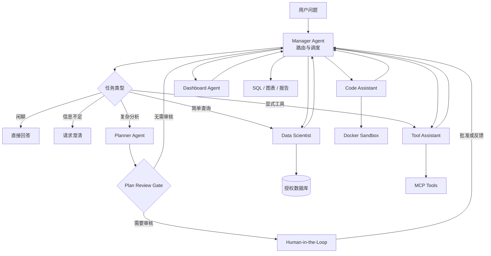
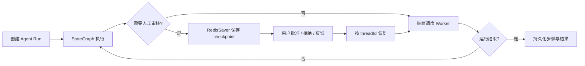
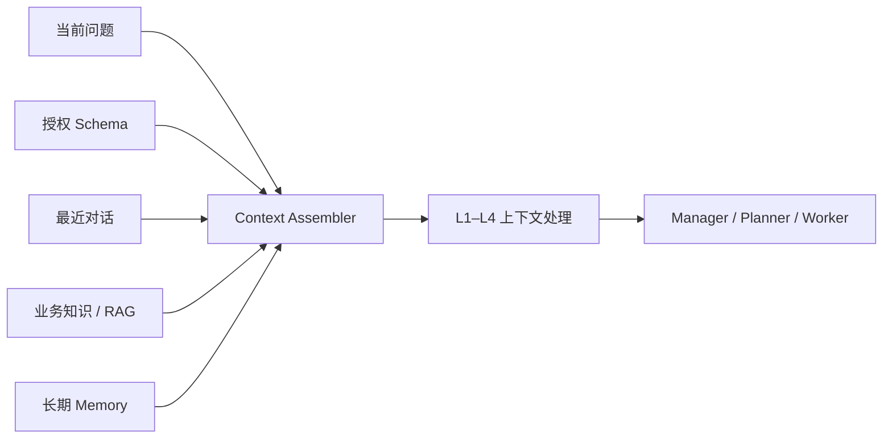
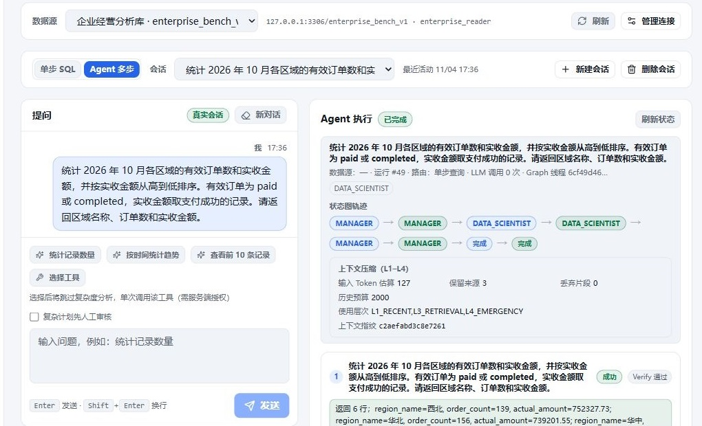
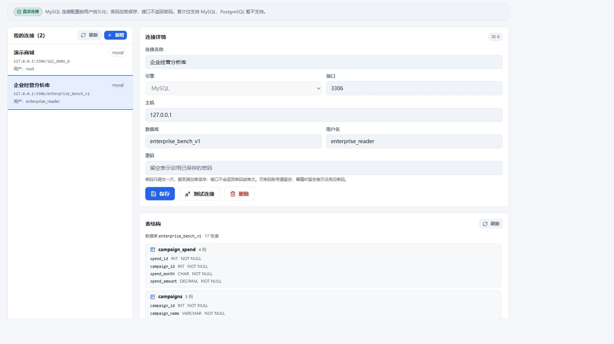
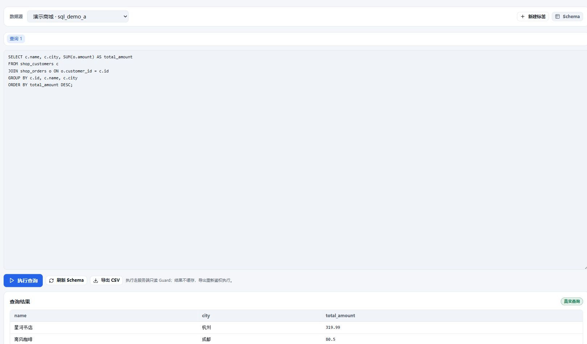
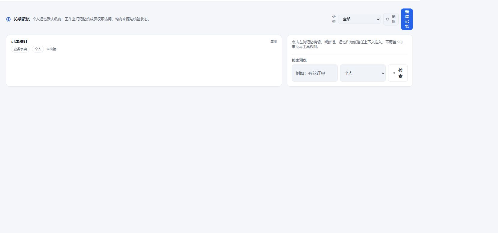
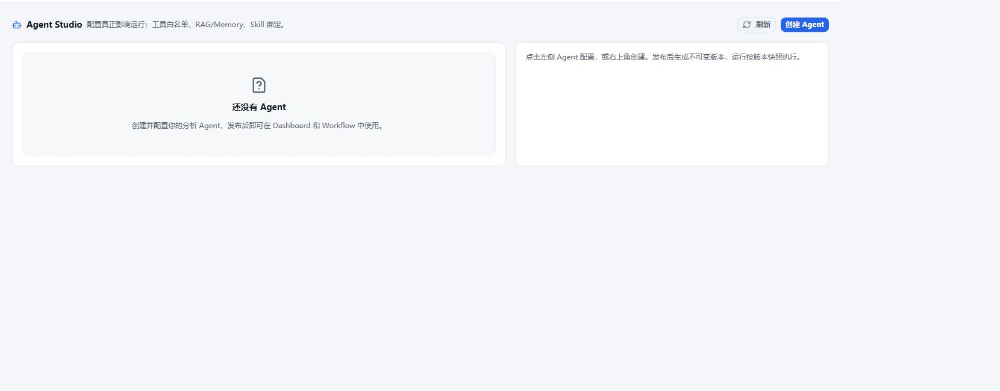
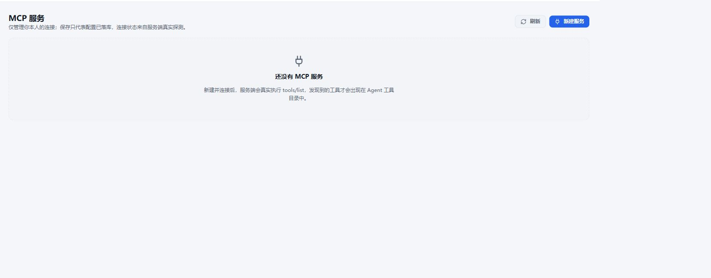
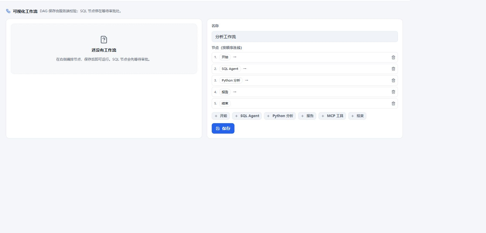

# QueryForge

<p align="center">
  <strong>面向真实数据库的 Multi-Agent 智能数据分析平台</strong><br>
  用自然语言完成任务规划、SQL 查询、数据分析与报告生成
</p>

<p align="center">
  
  
  
  
  
  
</p>

<p align="center">
  <a href="#项目简介">项目简介</a> ·
  <a href="#核心能力">核心能力</a> ·
  <a href="#系统架构">系统架构</a> ·
  <a href="#后端核心能力">后端能力</a> ·
  <a href="#快速开始">快速开始</a> ·
  <a href="#功能截图">功能截图</a>
</p>

---

## 项目简介

**QueryForge** 是一个连接真实 MySQL 数据库的智能数据分析平台。用户用自然语言描述业务问题后，系统会读取当前用户有权访问的 Schema，由 Manager、Planner 和专业 Worker Agent 协作完成意图判断、任务拆解、SQL 生成与安全执行、Python 分析、图表及报告生成。

平台将模型决策与后端执行分离：大模型负责理解需求、制定计划和生成候选内容；Java 服务负责身份鉴权、数据源授权、SQL 只读校验、查询限额、人工审核、状态恢复和结果持久化。简单问题可以直接查询，复杂问题可以进入多步骤 Agent 工作流。

例如，用户可以直接提出：

> 统计所有订单数量和总金额。

> 按月分析各区域销售趋势，并生成图表和经营报告。

> 找出消费金额最高的客户，再结合业务口径解释结果。

## 核心能力

QueryForge 最重要的功能不是单次生成 SQL，而是把一个业务问题完整推进为**可计划、可执行、可审核、可恢复的真实数据分析任务**。

| 核心功能 | 能力说明 |
| --- | --- |
| **Multi-Agent 数据分析闭环** | Manager 负责路由和收敛，Planner 拆解复杂任务，Data Scientist、Code Assistant、Tool Assistant、Dashboard Agent 协作完成 SQL、分析与报告。 |
| **真实数据库安全查询** | 基于当前用户被授权的数据源与 Schema 生成 SQL，经只读 Guard、跨库限制、超时与行数限制后执行，不让模型直接控制数据库。 |
| **Human-in-the-Loop 与断点恢复** | 复杂计划和 SQL 节点可以暂停等待人工审批；批准、拒绝或补充反馈后，从 Redis checkpoint 与 MySQL 状态继续运行。 |
| **多轮上下文与长期记忆** | L1–L4 上下文压缩保留关键事实，业务知识与 pgvector RAG 提供语义证据，成功运行可提取长期 Memory 供后续任务召回。 |
| **隔离分析与工具扩展** | 查询结果可进入 Docker Python 沙箱；MCP Server、内置工具、Skills 与 DAG Workflow 扩展分析边界。 |
| **多用户平台治理** | Workspace 隔离成员和资源，Agent Studio 管理运行配置，模型路由、调用记录、配额和审计集中治理。 |

---

## 系统架构

### Multi-Agent 协作



专业 Agent 不直接决定最终状态。每个 Worker 将结构化结果返回 Manager，由 Manager 根据计划依赖、执行状态和权限边界选择下一步。

### Agent 角色

| Agent | 职责 | 输出 |
| --- | --- | --- |
| **Manager** | 判断意图、选择路由、调度步骤、收敛运行 | 执行路径、下一步骤、最终结论 |
| **Planner** | 将复杂问题拆成带依赖关系的计划 | 结构化步骤、角色分配、依赖关系 |
| **Data Scientist** | 生成、校验、修复并执行 SQL | SQL、查询结果、数据摘要 |
| **Code Assistant** | 消费前序数据并生成分析代码 | Python 分析结果、图表工件 |
| **Tool Assistant** | 发现并调用已授权 MCP 工具 | 外部工具结果 |
| **Dashboard Agent** | 汇总成功步骤与工件 | HTML 报告、图表和业务总结 |

### 请求路由

| 路径 | 适用场景 | 处理方式 |
| --- | --- | --- |
| **Chitchat** | 问候、能力咨询、普通交流 | Manager 直接回复，不进入 SQL 流程 |
| **Clarify** | 缺少目标表、时间范围或统计口径 | 请求用户补充信息后再继续 |
| **Simple** | 单个只读 SQL 可以回答 | Data Scientist 直接查询并总结 |
| **Complex** | 多步骤、图表、Python 分析或报告 | Planner 规划，多个 Worker 协作执行 |
| **Tool** | 用户显式选择某个工具 | 跳过复杂度判断，交给 Tool Assistant |

### 可恢复执行



Graph 运行、计划版本和审批状态同时受 Redis checkpoint 与 MySQL 状态约束。页面刷新或服务恢复后，用户仍可从同一个运行继续，而不需要让一个 HTTP 请求持续等待。

### 上下文与记忆



- **L1**：保留最近对话和当前任务信息。
- **L2**：在预算压力下裁剪较早轮次。
- **L3**：通过摘要保留历史事实和约束。
- **L4**：模型上下文异常时执行紧急压缩。
- **长期 Memory**：从成功运行中异步提取候选记忆，经校验、去重和权限过滤后用于后续召回。

---

## 模块结构

项目按照业务能力拆分，每个业务包内部再组织应用服务、领域对象、接口契约和基础设施适配。

```text
ZZJ-NL2SQL-backend/
├── zzj-service/                     # 核心业务与 Agent 引擎
│   └── src/main/java/com/queryforge/
│       ├── application/
│       │   ├── agent/               # Manager、Planner、StateGraph、Worker Bus、HITL
│       │   ├── datasource/          # 数据源与 Schema
│       │   ├── query/               # SQL 生成、执行与历史
│       │   ├── analysis/            # Python 分析与工件
│       │   ├── report/              # 报告生成
│       │   ├── rag/                 # 业务知识与语义检索
│       │   ├── memory/              # 长期记忆
│       │   ├── mcp/                 # MCP Server 与工具目录
│       │   ├── workflow/            # DAG 工作流与审批
│       │   ├── studio/              # Agent 配置与发布
│       │   └── workspace/           # 成员与资源授权
│       ├── domain/                  # 领域模型与业务规则
│       ├── infrastructure/          # JDBC、Redis、LLM、pgvector 等适配器
│       └── trigger/                 # REST、SSE 与内部 RPC 入口
├── zzj-sandbox/                     # Docker Python 沙箱
├── zzj-gateway/                     # API Gateway 与会话校验
├── zzj-admin/                       # 平台管理服务
├── zzj-common/                      # 跨模块契约
├── docker/                          # 本地环境脚本与数据库初始化
├── compose.yaml                     # 完整本地环境
└── pom.xml                          # Maven Reactor
```

## 后端核心能力

### Agent 引擎

- 基于 StateGraph 的 Manager / Planner / Worker 编排，支持 Chitchat、Clarify、Simple、Complex、Tool 五类路由。
- Data Scientist、Code Assistant、Tool Assistant、Dashboard Agent 按计划依赖协作，结果统一回到 Manager 收敛。
- Worker Bus 提供 OFF / BYPASS / SWITCH 三种分派模式，并处理幂等、ACK、有限重试和失败回退。
- SSE 持续输出运行状态、步骤轨迹、模型调用与最终结论，支持客户端取消和运行详情回放。

### 数据库与 SQL 安全

- MySQL 数据源创建、修改、测试与用户隔离。
- 按连接 ID 复用 HikariCP 目标连接池，并通过 Caffeine 缓存 Schema；配置变更、淘汰或删除时同步关闭旧池并失效缓存。
- 自然语言生成 SQL、流式输出和显式执行。
- 多标签 SQL Console、结果表格与 CSV 导出。
- JSQLParser 只读检查、跨库限制、超时和最大行数控制。
- SQL 错误分类、有限次数自动修复、查询历史和会话关联。

### 状态、审批与恢复

- RedisSaver 按 `threadId` 保存 Graph checkpoint，页面刷新或服务恢复后仍可继续同一运行。
- 计划级 Human-in-the-Loop 支持批准、拒绝、修改意见和重新规划。
- MySQL 持久化运行、计划版本、步骤与审批状态，结合原子状态更新避免重复领取和重复执行。
- Redisson 用于跨实例协调；依赖不可用时按安全策略收敛，不绕过审批或权限检查。

### 上下文、知识与记忆

- L1–L4 上下文处理组合最近消息、历史摘要、授权 Schema、知识证据和运行状态，在预算内保留任务约束。
- 业务术语、审核 SQL 示例与问答知识按用户、Workspace、连接范围检索。
- pgvector 保存知识与 Memory 向量，检索时强制用户、连接、类型和有效状态过滤。
- 成功运行异步提取长期记忆，经过格式校验、重要性评分、指纹去重和来源记录后持久化；后台任务执行衰减与软归档。

### 分析、工具与工作流

- Docker 隔离的 Python 分析与图表工件。
- 沙箱不可用时拒绝回退到宿主机执行模型生成代码。
- MCP Server 管理、SSE / Stdio 连接、`tools/list` 发现、白名单授权和参数校验。
- DAG 工作流串联 SQL Agent、Python 分析、MCP 工具和报告节点，SQL 节点进入人工审批后再执行。
- Cron 调度、节点状态、运行历史和失败信息持久化。
- HTML 报告预览与分析结果回溯。

### 身份、配置与治理

- Agent Studio 草稿、发布版本、回滚和运行配置。
- Skills 可复用任务指引。
- Workspace 成员、角色与数据源等资源授权。
- 数据源密码和模型密钥由服务端加密保存，接口不返回密文或明文。
- 模型配置、路由、调用记录、配额和审计。

---

## 技术栈

| 方向 | 技术 |
| --- | --- |
| 后端 | Java 21、Spring Boot 3.5.6、Spring MVC、SSE |
| Agent | Spring AI 1.1.8、Spring AI Alibaba Graph 1.1.2.0 |
| 数据访问 | MyBatis-Plus、Spring JDBC、HikariCP、Caffeine |
| 数据与状态 | MySQL 8.4、Redis、Redisson、PostgreSQL 17、pgvector |
| 服务治理 | Spring Cloud Gateway、Nacos、Dubbo、Sa-Token |
| SQL 安全 | JSQLParser、只读 JDBC、超时与行数限制 |
| 分析运行时 | Docker、Python 3.12 |
| 前端 | React 18、TypeScript、Vite 6、Tailwind CSS |

---

## 快速开始

### 环境要求

- JDK 21、Maven 3.9+
- Node.js 20+
- MySQL 8.4、Redis、PostgreSQL 17 + pgvector、Nacos
- Docker Desktop / Docker Engine + Compose v2（推荐）
- 一个兼容 OpenAI Chat Completions 的模型服务

### 1. 克隆前后端

前后端应位于同一个父目录下，目录名分别为 `backend` 和 `frontend`：

```bash
git clone https://github.com/zmzzj1/ZZJ-NL2SQL-backend.git backend
git clone https://github.com/zmzzj1/ZZJ-NL2SQL-front.git frontend
cd backend
```

### 2. 创建本地配置

Windows PowerShell：

```powershell
New-Item -ItemType Directory -Force config | Out-Null
Copy-Item .env.example config/local.properties
```

Linux / macOS：

```bash
mkdir -p config
cp .env.example config/local.properties
```

编辑 `config/local.properties`，至少配置：

```properties
app.security.encryption-key=<32 字节随机密钥的 Base64>
app.llm.base-url=<OpenAI 兼容地址>
app.llm.api-key=<API Key>
app.llm.model=<模型名>
```

密钥和密码只保存在本地配置中，不要提交到 Git。

### 3. Docker Compose 启动

使用 Compose 时，删除 `config/local.properties` 中的 `app.management.url`、`app.management.username` 和 `app.management.password` 占位项，让应用读取 Compose 注入的管理库配置。

Windows：

```powershell
powershell -ExecutionPolicy Bypass -File .\docker\start.ps1
```

Linux / macOS：

```bash
cp docker/.env.example docker/.env
# 编辑 docker/.env 后启动
docker compose --env-file docker/.env up -d --build --wait
```

默认入口：

- 前端：`http://127.0.0.1:5174/`
- 网关健康检查：`http://127.0.0.1:8080/api/health`
- Nacos 控制台：`http://127.0.0.1:8082/`

Windows 停止命令：

```powershell
powershell -ExecutionPolicy Bypass -File .\docker\stop.ps1
```

### 4. 本地构建

```bash
# 后端
./mvnw verify

# 前端
cd ../frontend
npm install
npm run check
```

---

## 配置

| 配置 | 用途 |
| --- | --- |
| `app.management.*` | QueryForge 管理库连接 |
| `app.security.encryption-key` | 数据源密码 AES-GCM 加密密钥 |
| `app.connection-policy.*` | 允许连接的目标主机、端口和超时 |
| `app.llm.*` | Chat 模型地址、密钥、模型名和超时 |
| `app.embedding.*` | Embedding 模型和向量维度 |
| `app.pg.*` | pgvector 数据源 |
| `app.agent.*` | 最大步骤、修复次数和模型调用预算 |
| `app.analysis.*` | Python 沙箱输入、资源和时间限制 |
| `app.memory.maintenance.*` | 长期记忆衰减与归档策略 |

默认配置及完整环境变量映射见后端仓库的 [`application.yml`](https://github.com/zmzzj1/ZZJ-NL2SQL-backend/blob/main/zzj-service/src/main/resources/application.yml)。

## 主要 API

以下接口统一通过 Gateway 的 `/api` 前缀访问；业务接口需要有效登录态和资源权限。

| 场景 | 方法与路径 |
| --- | --- |
| 创建 Agent Run | `POST /api/v1/agent/runs/stream` |
| 查看 Agent Run | `GET /api/v1/agent/runs/{runId}` |
| 继续计划审核 | `POST /api/v1/agent/runs/{runId}/plan/continue/stream` |
| 生成 SQL | `POST /api/v1/sql/generate/stream` |
| 执行只读 SQL | `POST /api/v1/sql/execute` |
| 运行 Python 分析 | `POST /api/v1/analysis/runs/stream` |
| 运行工作流 | `POST /api/v1/workflows/{id}/runs/stream` |
| 管理数据源 | `/api/v1/connections/**` |
| 管理长期记忆 | `/api/v1/memories/**` |
| 管理 Agent | `/api/v1/studio/agents/**` |
| 管理 MCP Server | `/api/v1/mcp-servers/**` |

---

## 项目地址

- [QueryForge 后端](https://github.com/zmzzj1/ZZJ-NL2SQL-backend)
- [QueryForge 前端](https://github.com/zmzzj1/ZZJ-NL2SQL-front)

---

## 功能截图

### 企业经营分析对话

在 `enterprise_bench_v1` 真实数据库中，用户一次提出“统计各区域有效订单数和实收金额”的业务问题，Manager 与 Data Scientist 自动关联订单、门店、区域和支付数据，生成并执行只读 SQL，同时展示状态轨迹、查询结果与最终结论。



### 数据库连接与 Schema

连接按用户隔离，密码由服务端加密保存；图中企业经营分析库使用独立只读账号，模型只会接收到当前用户被授权的数据源与 17 张业务表 Schema。



### SQL Console

SQL Console 支持多标签编辑、Schema 刷新、只读执行与 CSV 导出，查询仍需经过服务端权限检查和 SQL Guard。



### 长期记忆

个人与 Workspace 记忆按权限隔离，记录来源和核验状态，并作为低信任上下文参与后续 Agent 运行。



### Agent Studio

Agent Studio 管理工具白名单、RAG / Memory、Skills 等运行配置，发布后生成不可变版本供运行快照使用。



### MCP 服务

用户可以配置 MCP Server；服务端连接成功并完成工具发现后，工具才会进入 Agent 工具目录。



### 可视化工作流

工作流以 DAG 组织 SQL Agent、Python 分析、MCP 工具和报告节点，SQL 节点执行前进入人工审批。


